# 🗺️ Mapa Lógico do Frontend — Zenith Financial

> Gerado em: 2026-11-08 | Baseado em análise estática de `src/`

---

## 1. Hierarquia de Renderização

```mermaid
graph TD
    A["App.tsx\n(Roteador + Estado Global)"]

    A --> AUTH["AuthView\n(login / cadastro)"]
    A --> HOME["HomeView\n(aba Início)"]
    A --> WALLET["WalletTransactionsView\n(aba Carteira)"]
    A --> INVEST["InvestmentsView\n(aba Investimentos)"]
    A --> IA["ZenithIAView\n(aba IA)"]
    A --> STORAGE["StorageTrashView\n(via ProfileDrawer)"]

    %% Modais globais montados no App
    A --> M1["AddTransactionModal"]
    A --> M2["AssetModal / AssetDeepDiveModal / AddAssetModal"]
    A --> M3["CategoryDetailModal"]
    A --> M4["IngestionHub + ReviewModal"]
    A --> M5["ProfileDrawer"]
    A --> M6["FinancialCalendarModal"]

    %% HomeView → Dashboard Components
    HOME --> D1["PatrimonyEvolutionChart"]
    HOME --> D2["GoalsHeroCard"]
    HOME --> D3["FutureHeroCard"]
    HOME --> D4["AssetAllocationChart"]
    HOME --> D5["CashFlowChart"]
    HOME --> D6["CategoryDistributionChart"]
    HOME --> D7["GoalsProgressChart"]
    HOME --> D8["MiniMetricCard"]
    HOME --> D9["AssetMiniCard"]
    HOME --> D10["DDASuggestion"]
    HOME --> D11["YieldProjectionCard ⚠️"]
    HOME --> D12["YieldReconciliationModal"]

    %% ZenithIAView → Chat Components
    IA --> C1["ChatMessageBubble"]
    IA --> C2["ChatInputBar"]

    %% Hooks
    A --> H1[("useZenithData\norquestrador")]
    H1 --> H2[("useTransactionsData")]
    H1 --> H3[("useAssetsData")]
    H1 --> H4[("useAuxiliaryData")]
    H1 --> H5[("useUserSettings")]
    IA --> H6[("useAITools")]
    IA --> H7[("useVoiceRecognition")]

    %% Shared hooks
    HOME --> HP[("usePersistentState")]
    IA --> HP

    %% UI Primitives (parcialmente usados)
    subgraph UI ["src/components/ui/ (Primitivos)"]
        UI1["Modal.tsx\ncenter / sheet"]
        UI2["Overlay.tsx\nPortal + backdrop"]
    end

    M1 --> UI1
    UI1 --> UI2

    %% Estilos
    classDef view     fill:#1a2235,stroke:#00FFA3,color:#F0F4FF
    classDef comp     fill:#13171F,stroke:#3b82f6,color:#F0F4FF
    classDef hook     fill:#0d1117,stroke:#a855f7,color:#F0F4FF
    classDef modal    fill:#1a1225,stroke:#f59e0b,color:#F0F4FF
    classDef warning  fill:#2a1515,stroke:#ef4444,color:#F0F4FF
    classDef ui       fill:#0f1a0f,stroke:#22c55e,color:#F0F4FF

    class HOME,WALLET,INVEST,IA,STORAGE,AUTH view
    class D1,D2,D3,D4,D5,D6,D7,D8,D9,D10,D12,C1,C2 comp
    class H1,H2,H3,H4,H5,H6,H7,HP hook
    class M1,M2,M3,M4,M5,M6 modal
    class D11 warning
    class UI1,UI2 ui
```

> [!WARNING]
> `YieldProjectionCard.tsx` está em `src/views/` mas é **importado como componente** por `HomeView.tsx`.
> Deve ser movido para `src/components/dashboard/`.

---

## 2. Componentes do Dashboard

| Arquivo | Props Principais | O que renderiza |
|---|---|---|
| `MetricCards.tsx` (`MiniMetricCard`) | `id`, `label`, `value: string\|number`, `percent: string`, `trend: 'up'\|'down'`, `data?: {v:number}[]`, `color?`, `privacy?`, `onSettings?`, `overlayDetails?` | Card flip: frente com miniatura AreaChart (Recharts) + badge de variação; verso com overlay de dados detalhados. Lazy-render via `useInView`. |
| `MetricCards.tsx` (`AssetMiniCard`) | `asset`, `cdiAnnualPercent: number`, `privacy?`, `onSettings?` | Card vertical 9:16 (tipo stories) com flip: frente valor do ativo; verso projeção + slider de horizonte (Hoje / 1m / 6m / 1a). |
| `MetricCards.tsx` (`DDASuggestion`) | `dda: DDA`, `onAccept`, `onReject`, `privacy: boolean`, `language: string` | Card animado (height 0→auto) com dados do débito automático e botões Aceitar / Rejeitar. |
| `MetricCards.tsx` (`PortfolioHeroCard`) | `totalBalance`, `dailyTotal`, `monthTotal`, `yearTotal`, `assetCount`, `avgPercent`, `chartData?`, `projectionValues?`, `privacy?`, `onSettings?` | Card hero com total do portfólio, flip com projeções e slider de período. |
| `FutureHeroCard.tsx` | `currentNetWorth: number`, `assets`, `transactions`, `cdiAnnualPercent: number`, `privacy: boolean`, `onTogglePrivacy` | AreaChart de projeção futura com tabs 30 dias / 12 meses / 5 anos. Lógica de sweep entre ativos via `useMemo`. |
| `GoalsHeroCard.tsx` | `currentNetWorth: number`, `transactions`, `assets`, `target?: number`, `privacy: boolean` | Barra de progresso da meta patrimonial + previsão em meses + painel debug expansível. |
| `PatrimonyEvolutionChart.tsx` | `evolutionView: 'historico'\|'projecao'`, `projectionTaxMode: 'liquido'\|'bruto'`, `computedProjectionData`, `chartData`, `visualType?`, `mainColor?`, `opacity?`, `isGradient?`, `tooltipsEnabled?`, `privacyMode: boolean`, `t` | AreaChart ou BarChart (Recharts) de evolução patrimonial. Suporta múltiplos tipos visuais (Candles, Linha, Área, Barra, Coluna). |
| `AssetAllocationChart.tsx` | `allocationData`, `chartFilterValue`, `setChartFilterValue`, `opacity?`, `tooltipsEnabled?`, `privacyMode: boolean`, `onNavigateTab`, `openDrawer`, `metrics`, `investorProfile`, `portfolioAllocationPercent`, `assets`, `onSelectAsset`, `t` | PieChart de alocação por tipo de ativo + lista de ativos clicáveis + `HomeInvestmentCard`. |
| `CashFlowChart.tsx` | `cashFlowData`, `mainColor?`, `opacity?`, `tooltipsEnabled?`, `showValues?`, `openDrawer`, `t` | BarChart (Recharts) de fluxo de caixa mensal; barras coloridas por positivo/negativo. |
| `CategoryDistributionChart.tsx` | `transactions`, `recentTransactions`, `chartFilterValue`, `setChartFilterValue`, `opacity?`, `tooltipsEnabled?`, `privacyMode: boolean`, `onNavigateTab`, `openDrawer`, `t` | PieChart de categorias de gasto + lista de transações recentes filtráveis. |
| `GoalsProgressChart.tsx` | `goals: {name, current, target, percent, color}[]`, `resolvedGoalTargets`, `onSaveGoalTargets?`, `opacity?`, `t` | Lista de metas com barras de progresso (Recharts LinearGauge). Modo de edição inline de valores. |
| `YieldReconciliationModal.tsx` | `assets`, `onClose: () => void`, `onSave: (updatedAssets) => void` | Overlay modal com inputs de rendimento diário/fim-de-semana por ativo. ⚠️ Não usa `Modal.tsx`. |
| `DashboardTimeline.tsx` | `transactions: Transaction[]`, `privacyMode: boolean`, `t` | Lista das 3 últimas transações com ícone, label, categoria e valor colorido. |
| `Timeline.tsx` | `transactions: Transaction[]`, `privacyMode: boolean` | Transações agrupadas por data, total do dia e indicadores entrada/saída/transferência. |
| `YieldProjectionCard.tsx` ⚠️ em `views/` | *(arquivo em local incorreto)* | Card de projeção de rendimentos. **Deve ser movido para `components/dashboard/`.** |

---

## 3. Componentes do Chat IA

| Arquivo | Props Principais | O que renderiza |
|---|---|---|
| `ChatMessageBubble.tsx` | `msg: Message`, `index: number`, `activeModelName: string`, `isLoading: boolean`, `copiedIndex`, `editingIndex`, `editText`, `speakingIndex`, `likedIndices`, `language?`, `onCopy`, `onShare`, `onSpeak`, `onLike`, `onRetry`, `onEditStart`, `onEditTextChange`, `onEditConfirm`, `onEditCancel`, `messages: Message[]` | Balão de mensagem. Usuário: fundo verde, alinhado à direita; IA: card escuro com `ReactMarkdown`. Suporta edição inline (user), ações pós-mensagem (copy / share / áudio / like / retry), badge de modelo e badge de erro com retry. |
| `ChatInputBar.tsx` | `input: string`, `isLoading: boolean`, `isListening: boolean`, `activeModelName`, `showModelSelector`, `showQuickActions`, `availableModels: GeminiModel[]`, `language?`, `textareaRef`, `onInputChange`, `onSend`, `onKeyDown`, `onToggleVoice`, `onToggleModelSelector`, `onToggleQuickActions`, `onSelectModel`, `onSelectQuickAction` | Container fixo `bottom-[78px]` com: popover de seleção de modelo Gemini (AnimatePresence), popover de ações rápidas com 5 prompts pré-definidos, textarea auto-expandível, botões (+), seletor de modelo (pill + indicador verde pulsante), microfone (vermelho quando ativo) e enviar (desabilitado quando vazio). |

---

## 4. Componentes Visuais Duplicados Fora de `src/components/ui/`

> [!CAUTION]
> Os padrões abaixo aparecem em **múltiplos arquivos** implementados inline. São candidatos
> prioritários a virar primitivos em `src/components/ui/` antes do lançamento.

### 4.1 `<Card>` — Container padrão bg-card + border + rounded
**Padrão inline:** `className="bg-[var(--bg-card)] border border-[var(--border-card)] rounded-[32px] p-6"`

| Arquivo | Ocorrência |
|---|---|
| `HomeView.tsx` | Seções de chart e patrimônio |
| `WalletTransactionsView.tsx` | Card de saldo do mês |
| `AuthView.tsx` | Form container |
| `ZenithIAView.tsx` | Empty state e loading bubble |
| `MetricCards.tsx` | DDASuggestion |

**Primitivo ausente:** `<Card>` em `src/components/ui/Card.tsx`

---

### 4.2 `<TabSwitcher>` / `<SegmentedControl>` — Grupo de tabs pill
**Padrão inline:** botões com `bg-[var(--accent)] text-[var(--bg-app)]` (ativo) vs `text-[var(--text-muted)]` (inativo)

| Arquivo | Uso |
|---|---|
| `WalletTransactionsView.tsx` | Filtro de período (Mês Atual / Anterior / Todos) |
| `InvestmentsView.tsx` | Tabs Ativos / Subcategorias / Estratégias |
| `HomeView.tsx` | Toggle lista / grade / carrossel |
| `FutureHeroCard.tsx` | Tabs 30 Dias / 12 Meses / 5 Anos |
| `GlobalSettingsSection.tsx` | Tema Claro / Escuro / Contraste |

**Primitivo ausente:** `<TabSwitcher>` em `src/components/ui/TabSwitcher.tsx`

---

### 4.3 `<Spinner>` — Spinning ring duplicado (componente existente ignorado)
**Padrão inline:** `
`

| Arquivo | Ocorrências |
|---|---|
| `App.tsx` | 3 locais (estados de loading de auth e settings) |
| `ZenithIAView.tsx` | Loading bubble inline |

> [!NOTE]
> `src/components/LoadingSpinner.tsx` **já existe** mas não é reutilizado nesses locais.

---

### 4.4 Overlay de Modal fullscreen inline — não usa `Modal.tsx`
**Padrão inline:** `
`

| Arquivo | z-index | Descrição |
|---|---|---|
| `App.tsx` | z-100 | BiometryModal (inline) |
| `App.tsx` | z-150 | AddMenuModal (inline) |
| `ZenithIAView.tsx` | z-50 | Overlay de histórico de sessões |
| `YieldReconciliationModal.tsx` | z-50 | Modal de conciliação |

> [!NOTE]
> `Modal.tsx` e `Overlay.tsx` em `src/components/ui/` **já existem** mas não são usados nesses 4 casos.

---

### 4.5 `<ChartTooltip>` do Recharts — customização duplicada
**Padrão inline:** `content={({ active, payload }) => active && payload?.length ? 
 : null}`

| Arquivo |
|---|
| `FutureHeroCard.tsx` |
| `PatrimonyEvolutionChart.tsx` |
| `CashFlowChart.tsx` |
| `CategoryDistributionChart.tsx` |

**Primitivo ausente:** `<ChartTooltip>` em `src/components/ui/ChartTooltip.tsx`

---

## 5. Métricas de Complexidade

> [!WARNING]
> Arquivos próximos ou acima do limite de **500 linhas** definido no `AGENTS.md`:

| Arquivo | Linhas | Status |
|---|---|---|
| `useZenithData.ts` | 953 | 🔴 God hook — crítico |
| `HomeView.tsx` | 988 | 🔴 God view — crítico |
| `ZenithIAView.tsx` | 720 | 🔴 Acima do limite |
| `MetricCards.tsx` | 655 | 🔴 Acima do limite |
| `DashboardSlotConfigItem.tsx` | 315 | ✅ |
| `ChatMessageBubble.tsx` | 300 | ✅ |
| `ChatInputBar.tsx` | 245 | ✅ |
| `useAITools.ts` | 485 | 🟡 No limite |

---

## 6. Primitivos em `src/components/ui/` — Inventário

| Arquivo | Variantes | Status de Adoção |
|---|---|---|
| `Modal.tsx` | `center` / `sheet` | ⚠️ Pouco adotado — 4 overlays inline ignoram-no |
| `Overlay.tsx` | Portal + backdrop animado | ⚠️ Dependência interna do `Modal` apenas |

**Primitivos ausentes — candidatos a criar:**

| Primitivo | Prioridade | Duplicações detectadas |
|---|---|---|
| `Card.tsx` | 🔴 Alta | 5+ arquivos |
| `TabSwitcher.tsx` | 🔴 Alta | 5+ arquivos |
| `ChartTooltip.tsx` | 🟡 Média | 4 arquivos |
| `Button.tsx` | 🟡 Média | padrão accent/secondary repetido |
| `Spinner.tsx` | 🟡 Média | já existe `LoadingSpinner`, basta adotar |
