# Diagnóstico Profundo (Deep Dive): Área de Configurações do Zenith Financial

> **Perfil do Auditor:** Product Architect & UX Auditor Sênior  
> **Objetivo:** Preparação para Lançamento Comercial (Mobile-First / Fintech)  
> **Status:** Diagnóstico Técnico & de Experiência do Usuário (Nenhum código foi modificado)  
> **Data:** 09/11/2026

---

## Sumário Executivo

A auditoria arquitetural e de UX da área de configurações revelou um cenário clássico de **dívida técnica evolutiva**: o aplicativo possui módulos modernos e robustos no domínio (`src/domain`), mas sua camada de configurações e preferências sofre com **fragmentação de estado, duplicidade de controles concorrentes e controles "placebo"** (que existem visualmente, mas não exercem efeito no motor do aplicativo).

Para um lançamento comercial seguro e competitivo, a área de configurações precisa ser consolidada como o centro de confiança, conformidade jurídica (LGPD/Apple Guidelines) e personalização do usuário.

---

## 1. Painéis de Cards e Charts: Mapeamento e Padronização

### 1.1. Existe uma padronização?
**Não.** O app possui dois sistemas concorrentes e inconsistentes de configuração de cards e gráficos:
1. **Configuração por Slot no Dashboard (`HeritageSettings` + `DashboardSlotConfigItem`):** Tenta gerenciar slots individuais através de um array `dashboard_order` salvo no Firestore.
2. **Painel Global Genérico de Cards (`CardSettingsPanel`):** Tenta aplicar propriedades universais (`chartHeight`, `lineThickness`, `fontFamily`, `textSizeScale`, `cardBgOpacity`, `textOpacity`, `showAxes`, `showProjections`) gravadas no `localStorage`.

### 1.2. Gráficos com Controle vs. Gráficos "Mudos"

| Card / Gráfico | Localização | Tipo de Controle Atual | Nível de Controle | Comportamento Real |
| :--- | :--- | :--- | :--- | :--- |
| **Evolução Patrimonial** (`CHART_EVOL_PATRIMONIO`) | Home (Carrossel Superior) | `DashboardSlotConfigItem` + botões inline na Home | **Parcial / Desconexo** | Permite trocar cor, opacidade, tipo visual, timeframe e filtros de projeção. Porém, na Home ele fica fixado no primeiro slide do carrossel, fora do fluxo da lista integrada reordenável. |
| **Futuro / Projeção Hero** (`FutureHeroCard`) | Home (Slide 2 do Carrossel) | *Nenhum* | **100% Mudo** | Ausente do `dashboard_order` e de `HeritageSettings`. O usuário não pode ocultar, reordenar ou alterar suas premissas visuais. |
| **Metas Hero** (`GoalsHeroCard`) | Home (Embutido no Card de Patrimônio) | *Nenhum* | **100% Mudo** | Fixo abaixo do gráfico de evolução. Não possui controles de visibilidade independentes. |
| **Progresso de Metas** (`CHART_METAS_PROG`) | Home (Lista integrada) | Modal interno de edição + `DashboardSlotConfigItem` | **Funcional** | Possui botão de lápis para editar alvos em R$ e toggle de visibilidade/ordem. |
| **Alocação de Ativos** (`CHART_ALOC_ATIV`) | Home (Lista integrada) | Ícone de engrenagem → `openDrawer('settings')` + `DashboardSlotConfigItem` | **Funcional** | Responde a visibilidade, cor, opacidade e ordem. |
| **Fluxo de Caixa** (`CHART_FLUXO_CAIXA`) | Home (Lista integrada) | Ícone de engrenagem → `openDrawer('settings')` + `DashboardSlotConfigItem` | **Funcional** | Responde a visibilidade, cor, opacidade e ordem. |
| **Distribuição por Categoria** (`CHART_DIST_CATEG`) | Home (Lista integrada) | Ícone de engrenagem → `openDrawer('settings')` + `DashboardSlotConfigItem` | **Funcional** | Responde a visibilidade, cor, opacidade e ordem. |
| **Sazonalidade & Predição de Contas** (`CHART_SAZON_MENS`, `CHART_PREV_CONTAS`) | Home (Lista integrada) | `DashboardSlotConfigItem` | **Fictício (Placeholder)** | Aparecem na lista de configuração para reordenar/colorir, mas na Home são apenas cartões pontilhados estáticos ("IA Placeholder"). |
| **Métricas: Entradas e Saídas** (`METRIC_ENTRADAS`, `METRIC_SAIDAS`) | Home (MiniMetricCard) | Ícone de engrenagem → `openDrawer('settings')` + `DashboardSlotConfigItem` | **Funcional** | Suportam cor, opacidade e visibilidade. |
| **Métrica: Rendimentos** (`YieldProjectionCard`) | Home (Lista integrada) | *Nenhum na prática* | **Mudo para Estilo** | Possui um item correspondente em `HeritageSettings`, mas o componente `YieldProjectionCard` ignora completamente as cores e opacidades configuradas. |
| **Métrica: Saldo Total** (`METRIC_SALDO`) | Home (MiniMetricCard) | Ícone de engrenagem | **Parcialmente Órfão** | Não faz parte da lista padrão `DEFAULT_DASHBOARD_ORDER` de `HeritageSettings`. |
| **Ativos Fixados no Dash** (`ASSET_{id}`) | Home (AssetMiniCard) | Ícone de engrenagem | **Mudo** | Abre as configurações gerais do drawer, mas não há painel para configurar individualmente o card daquele ativo no dashboard. |
| **Aba de Investimentos** (`InvestmentsView`) | View Dedicada | *Nenhum* | **100% Mudo** | Lista de ativos, subcategorias e estratégias não possui nenhuma configuração de ordenação, exibição ou agrupamento. |
| **Aba de Carteira / Extrato** (`WalletTransactionsView`) | View Dedicada | *Nenhum* | **100% Mudo** | Filtro apenas por período fixo (Mês Atual / Anterior / Todos), sem opções de personalização de colunas, ordenação ou cores. |

---

## 2. Tema Global vs. Customização Visual dos Cards

### 2.1. Como eles se integram (ou conflitam)?
A integração atual é uma **armadilha arquitetural com concorrência destrutiva**:
1. No `ProfileDrawer.tsx` (quando `page === 'settings'`), o app renderiza **empilhados no mesmo scroll**:
   - `CardSettingsPanel` ("Customização Visual")
   - `HeritageSettings` contendo `GlobalSettingsSection` ("Temas Visuais: Claro / Escuro / Contraste")
2. No [`App.tsx`](file:///data/data/com.termux/files/home/Zenith-Financial/src/App.tsx#L174-L180), existe a seguinte regra:
   ```typescript
   // Se o tema customizado estiver ativo, o tema global é ignorado
   // para não sobrescrever as variáveis CSS do custom.
   if (visualSettings.isCustomEnabled) return;
   const tema = settings?.zenith_config?.master_states?.tema_global || settings?.theme || 'Escuro';
   applyTheme(tema);
   ```
3. Quando `visualSettings.isCustomEnabled` está ativado (`true`):
   - O `App.tsx` injeta cores inline fixas (`--bg-app: #0a1a12`, `--text-primary: #FFFFFF`, etc.), forçando um esquema verde escuro.
   - O `useEffect` que aplica o tema global executa o `return` imediato.
   - **Consequência direta:** O usuário clica nos botões "Claro", "Escuro" ou "Contraste" e **o app não reage**. O seletor de tema global parece quebrado para o usuário.

### 2.2. A customização de cards realmente funciona?
**Quase 90% do `CardSettingsPanel` é código morto (placebo):**
* As propriedades `chartHeight`, `lineThickness`, `textColor`, `fontFamily`, `textSizeScale`, `cardBgOpacity`, `textOpacity`, `showAxes` e `showProjections` **não são lidas nem aplicadas por nenhum card ou gráfico Recharts do app**.
* Apenas `isCustomEnabled` e `accentColor` têm efeito prático (alterando a variável `--accent` no CSS).
* O usuário tem a falsa impressão de que está customizando a tipografia e dimensões dos gráficos, mas o código dos gráficos ignora essas propriedades.

---

## 3. Notificações: Auditoria de Infraestrutura e UX

### 3.1. Como está a implementação atual?
* **Zero Notificações Push Reais:** O projeto **não possui** `@capacitor/push-notifications` nem Firebase Cloud Messaging (FCM) configurados no Capacitor ou no `package.json`.
* **Listener Simples no Firestore:** O hook `useAuxiliaryData.ts` mantém um listener `onSnapshot` na coleção `notifications` filtrada por `uid`.
* **Notificação Falsa Injetada em Tempo de Execução:** O código injeta manualmente uma notificação mock permanente:
  ```typescript
  const reconciliationNotification = {
    id: 'reconciliation-pending',
    title: 'Rendimentos pendentes',
    message: 'Confira se os rendimentos de hoje batem com o extrato oficial.',
    action: 'open-reconciliation',
    createdAt: new Date().toISOString(),
    read: false,
  };
  setNotifications([reconciliationNotification, ...realNotifications]);
  ```
* **Efeito Sonoro Sintetizado:** Ao clicar no sino no cabeçalho do `App.tsx`, o app executa um sintetizador via Web Audio API (`AudioContext` gerando tons de 880Hz e 1108Hz) e abre o drawer na aba `notifications`.

### 3.2. Gerenciamento e Preferências
* **Zero Gestão de Preferências:** Não existe nenhuma interface para o usuário configurar o que deseja receber (ex: alertas de gastos, vencimento de boletos DDA, fechamento de mês, alertas de IOF/IR).
* **Lista Estática / Sem Ações:** O usuário não consegue marcar notificações individuais como lidas, arquivá-las ou excluí-las. A interface é puramente passiva.

---

## 4. Meu Perfil: Funcionalidades Atuais vs. Requisitos Comerciais

### 4.1. O que o usuário pode editar hoje?
Dentro de `ProfileDrawer.tsx` (`ProfileSection`):
1. **Foto de Perfil:** Upload de imagem local convertida para base64 (`imageFileToAvatar`, máx. 12MB) e salva diretamente no documento `users/{uid}`.
2. **Nome de Exibição:** Campo de texto livre (`displayName`).
3. **Perfil de Investidor:** Seletor dropdown (`'Conservador' | 'Sofisticado' | 'Arrojado'`).
4. **Email:** Apenas exibido em modo leitura.

### 4.2. O que falta para um Aplicativo Comercial (Fintech)?

| Requisito Comercial / Regulatório | Status Atual | Impacto no Lançamento |
| :--- | :---: | :--- |
| **Exclusão de Conta (Delete Account / Direito ao Esquecimento)** | ❌ **Inexistente** | **Bloqueador de Publicação.** A Apple App Store (Guideline 5.1.1(v)) e o Google Play exigem que qualquer app com criação de conta permita a exclusão completa da conta e dos dados diretamente pelo app. Sem isso, o app é reprovado na revisão. |
| **Alteração e Redefinição de Senha** | ❌ **Inexistente** | Usuários cadastrados via email/senha não têm onde alterar a senha ou disparar recuperação autenticada. |
| **Gestão de Provedores de Autenticação** | ❌ **Inexistente** | Não há indicação se o login é Google ou Email, nem opção de vincular/desvincular métodos. |
| **Gestão de Biometria Pós-Onboarding** | ❌ **Inexistente** | A biometria só é oferecida uma vez no primeiro login. Se o usuário escolher "Depois", nunca mais consegue ativar nas configurações. |
| **Logout Claro e Seguro** | ⚠️ **Parcial** | O botão "Sair da Conta" existe no rodapé do drawer, mas não limpa chaves sensíveis de sessão em cache local (`zenith_gemini_key`, biometria em `localStorage`). |
| **Dados Cadastrais & Compliance Financeiro** | ❌ **Inexistente** | Falta CPF/Telefone/Data de nascimento (essenciais para cálculo preciso de IR e futura integração Open Finance). |
| **Termos de Uso e Política de Privacidade (LGPD)** | ❌ **Inexistente** | Nenhum link para termos legais, aviso de privacidade ou registro de consentimento de tratamento de dados sensíveis. |
| **Exportação e Portabilidade de Dados** | ❌ **Inexistente** | Direito previsto no Art. 18 da LGPD (exportar dados financeiros em formato legível, como CSV/JSON). |

---

## 5. Chave de Inteligência Artificial: Auditoria de Segurança e UX

### 5.1. Como está a UI e o Fluxo de Entrada?
* Renderizada em `AiKeySection` dentro do `ProfileDrawer.tsx`.
* Possui um campo `input[type="password"]` com placeholder `AIza...`, link para o Google AI Studio e botão "Salvar chave".

### 5.2. Validação da Chave
* **Validação Prévia Inexistente:** O botão apenas verifica se o campo não está vazio (`!draft.trim()`). Ele **não valida** se a chave é sintaticamente válida, se tem permissão na API do Gemini ou se está ativa.
* **Feedback de Erro Assíncrono e Tardio:** Se o usuário digitar uma chave inválida (ex: `AIza1234`), a UI exibe "Chave salva neste navegador." com sucesso verde. O erro só se manifestará muito tempo depois, quando o usuário tentar conversar com a IA ou escanear um extrato, disparando uma exceção de API que reabre o drawer com o erro.

### 5.3. Segurança e Armazenamento
* **Texto Puro no `localStorage`:** A chave é persistida via `localStorage.setItem('zenith_gemini_key', trimmed)`.
* **Risco de Segurança:** O `localStorage` é acessível por qualquer script em execução no WebView/navegador (vulnerabilidade a ataques XSS). A chave não passa por nenhuma camada de encriptação simétrica local e não utiliza o Capacitor Secure Storage (Keystore no Android / Keychain no iOS).

---

## 6. Proposta de Nova Arquitetura da Informação (IA) para Configurações

Para transformar a experiência em um produto financeiro profissional, propõe-se substituir o drawer sobrecarregado por uma **Central de Configurações Modular**, organizada em 6 grupos lógicos claros:

```mermaid
graph TD
    SettingsHome["Configurações Gerais (Hub)"]
    
    SettingsHome --> SecProfile["1. Perfil & Conta"]
    SettingsHome --> SecAppearance["2. Preferências & Aparência"]
    SettingsHome --> SecDashboard["3. Gestão do Dashboard"]
    SettingsHome --> SecSecurity["4. Segurança & Privacidade"]
    SettingsHome --> SecAI["5. Inteligência Artificial"]
    SettingsHome --> SecLegal["6. Dados & Legal"]
    
    SecProfile --> P1["Nome, Foto & Dados Cadastrais"]
    SecProfile --> P2["Perfil de Investidor (Suitability)"]
    SecProfile --> P3["Credenciais & Alteração de Senha"]
    
    SecAppearance --> A1["Tema Visual (Sistema / Claro / Escuro / Alto Contraste)"]
    SecAppearance --> A2["Idioma Oficial (Português / Inglês / Espanhol)"]
    SecAppearance --> A3["Formatação Monetária & Termos Customizados"]
    
    SecDashboard --> D1["Lista Única Reordenável (Cards & Gráficos)"]
    SecDashboard --> D2["Preferências de Gráficos (Tooltips, Animações, Gradientes)"]
    SecDashboard --> D3["Metas Financeiras (Reserva & Liberdade)"]
    
    SecSecurity --> S1["Modo Privacidade Global (Ocultar Saldos)"]
    SecSecurity --> S2["Acesso por Biometria (Touch ID / Face ID)"]
    SecSecurity --> S3["Bloqueio por Inatividade / PIN"]
    
    SecAI --> I1["Provedor Ativo (Gemini / OpenAI / Claude)"]
    SecAI --> I2["Chave de API com Teste de Conexão em Tempo Real"]
    SecAI --> I3["Armazenamento Seguro (Keystore / Keychain)"]
    SecAI --> I4["Switch Real de Insights Autônomos"]
    
    SecLegal --> L1["Exportação de Dados (CSV / JSON)"]
    SecLegal --> L2["Termos de Uso & Política de Privacidade (LGPD)"]
    SecLegal --> L3["Zona de Perigo: Exclusão de Conta & Dados"]
    SecLegal --> L4["Sair da Conta (Logout Seguro)"]
```



### Detalhamento das 6 Seções Propostas:

#### 1. Perfil & Conta
* **Dados Pessoais:** Foto, Nome completo, Email autenticado.
* **Perfil do Investidor:** Conservador, Sofisticado ou Arrojado (com breve explicação de impacto na distribuição de ativos).
* **Segurança de Acesso:** Botão "Alterar Senha" (para contas email/senha) ou indicação "Autenticado via Google".

#### 2. Preferências & Aparência (Unificação Definitiva)
* **Tema Único e Consistente:** Substituir os dois painéis conflitantes por um seletor unificado de 4 opções: *Seguir Sistema*, *Escuro (Zenith Slate)*, *Claro*, *Alto Contraste*.
* **Acentuação Cromática:** Seletor de cor de destaque (`--accent`) que complementa o tema sem quebrar os fundos ou textos.
* **Idioma do App:** Dropdown diretamente vinculado a `settings.language` ('pt-BR' | 'en-US' | 'es-ES'), garantindo tradução imediata da interface.
* **Personalização de Rótulos:** Tela dedicada para configurar os `customTerms` (permitindo renomear "Saldo", "Patrimônio", "Investimentos").

#### 3. Gestão do Dashboard
* **Lista Reordenável Unificada:** Controle de ordem e visibilidade de todos os blocos do dashboard em um só lugar.
* **Remoção de Controles Mortos:** Eliminar os sliders genéricos de altura de gráfico e espessura de linha que não funcionam.
* **Configurações Específicas Contextuais:** Cada gráfico configurável em seu próprio modal focado (ex: premissas de projeção patrimonial no card de projeção).

#### 4. Segurança & Privacidade
* **Modo Privacidade Unificado:** Uma única chave de estado sincronizada no Firestore (`settings.privacyMode`), refletida simultaneamente no botão da Home e no switch de configurações.
* **Gestão de Biometria:** Toggle para ativar/desativar biometria a qualquer momento, testando o `PublicKeyCredential` do dispositivo.
* **Bloqueio por Tempo de Inatividade:** Opção para solicitar biometria ou senha após 1, 5 ou 15 minutos em background.

#### 5. Inteligência Artificial (Zenith AI Core)
* **Seleção de Provedor (Multi-Provedor):** Suportar a arquitetura `IAIProvider` já desenvolvida (permitindo selecionar Google Gemini, OpenAI ou Anthropic).
* **Validação de Chave em Tempo Real:** Ao colar a chave, um botão "Testar Conexão" faz uma chamada leve de verificação e exibe um badge verde ("Conectado") ou vermelho com o motivo exato retornado pela API.
* **Armazenamento Seguro:** Uso de storage encriptado no dispositivo para a chave da API.
* **Switch Real de Autonomia:** Fazer com que o interruptor de "Insights de IA" realmente ative ou silencie as sugestões automáticas nas telas.

#### 6. Dados, Conformidade & Zona de Perigo
* **Portabilidade de Dados (LGPD):** Botão para baixar backup completo dos dados financeiros (ativos, transações e configurações).
* **Termos & Políticas:** Links abertos em navegador ou modal com a Política de Privacidade e Termos de Serviço.
* **Exclusão de Conta (Delete Account):** Fluxo obrigatório com modal de dupla confirmação, purga completa das coleções do usuário no Firestore (`users`, `settings`, `assets`, `transactions`, `ddas`) e exclusão do registro no Firebase Authentication.
* **Sair da Conta (Logout Seguro):** Botão com confirmação que limpa caches locais e encerra a sessão com segurança.
