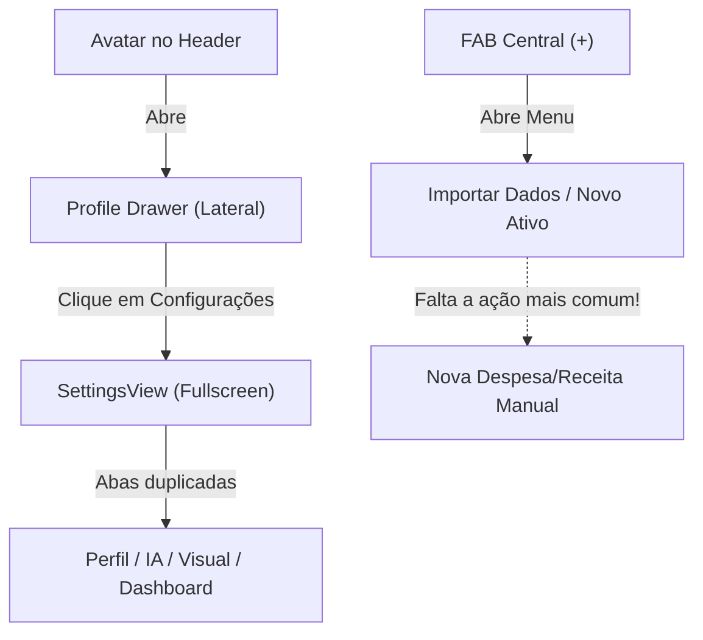
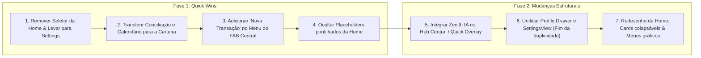

# 📊 Relatório de Auditoria UX & Arquitetura de Informação
**Projeto:** Zenith Financial  
**Papel:** UX Product Architect  
**Data:** 10 de Novembro de 2026  
**Status:** Análise Concluída — Aguardando Aprovação de Backlog  

---

## Executive Summary
O **Zenith Financial** possui fundações visuais e tecnológicas impressionantes (modo escuro refinado, microinterações, motor de IA autônomo e suporte a Capacitor/Mobile). No entanto, o rápido crescimento de funcionalidades gerou **pontos críticos de fricção cognitiva, redundâncias de navegação e desalinhamentos com heurísticas mobile consolidadas** (referências: Nubank, Apple Wallet e Stripe).

Este relatório disseca os gargalos atuais e estabelece a rota para transformar a experiência do Zenith em um produto financeiro mobile de classe mundial.

---

## 1. Análise de Navegação e Fluxo (Information Architecture)

### 1.1 Coexistência do Nav Dock, FAB Central e Profile Drawer
A estrutura atual apresenta três polos de navegação concorrentes:
1. **Nav Dock Inferior (5 slots):** `Início` | `Carteira` | `[FAB (+)]` | `Invest` | `Zenith IA`.
2. **FAB Central (+):** Botão verde flutuante de 64px centralizado que abre o menu *"O que deseja adicionar? (Importar Dados | Novo Investimento)"*.
3. **Profile Drawer Lateral:** Aberto pelo avatar no topo esquerdo, contendo *Menu, Meu Perfil, Notificações, Configurações, Chave da IA, Armazenamento/Lixeira*.

#### ⚠️ Problemas Identificados:
- **Redundância Drawer vs. SettingsView:** O Drawer lateral atua como um "menu antes do menu". Ao clicar em *Configurações* no Drawer, ele abre a tela cheia [`SettingsView.tsx`](file:///data/data/com.termux/files/home/Zenith-Financial/src/views/SettingsView.tsx), que repete abas que já estavam no Drawer (*Perfil, Aparência, IA, etc.*). Isso é um padrão de **camadas empilhadas desnecessárias** (*Modal sobre Drawer sobre View*).
- **A lacuna do FAB Central (+):** O botão central de adição oferece apenas *"Importar Dados"* e *"Novo Investimento"*. A ação financeira mais frequente do dia a dia de um usuário — **Adicionar uma Despesa / Receita Manual** — **não existe** no FAB central! O usuário é forçado a:
  1. Ir para a aba *Carteira*;
  2. Localizar o botão de texto fino `+ Nova Transação` no topo;
  3. Clicar para abrir o modal.  
  *Isso viola a expectativa primária de um FAB financeiro (como no Nubank ou Mobills).*
- **Sobrecarga de Abas no Dock:** Com 5 elementos na barra inferior em telas mobile compactas (<380px de largura), as áreas de toque ficam comprimidas (<48px de largura útil por aba), aumentando a taxa de toques acidentais (*fat-finger error*).

---

### 1.2 Profundidade de Cliques (Click Depth) em Ações Comuns

| Ação do Usuário | Cliques Atuais | Rota Atual | Ideal (Benchmarking) | Veredito |
| :--- | :---: | :--- | :---: | :--- |
| **Registrar gasto manual** | **3 a 4 cliques** | Aba Carteira → Topo da página → Botão `+` → Form | **1 clique** (FAB Central) | ❌ Crítico |
| **Consultar a Zenith IA** | **1 a 2 cliques** | Aba IA no Dock → Digitar prompt | **1 clique** (Chat contextual) | 🟡 Razoável |
| **Conciliar rendimentos** | **3 cliques + Scroll longo** | Aba Início → Rolar 7 gráficos até o rodapé → Clicar no botão | **1 clique** (Dentro da Carteira) | ❌ Incoerente |
| **Ver calendário de extratos** | **3 cliques + Scroll longo** | Aba Início → Rolar até o fim da página → Clicar no botão | **1 clique** (Filtro temporal na Carteira) | ❌ Incoerente |
| **Ajustar layout do dashboard** | **1 clique** | Direto no topo da Home | **Escondido em Ajustes** | ⚠️ Ocupa espaço nobre |

---

### 1.3 Avaliação da Thumb Zone (Zona do Polegar)

De acordo com o modelo de Steven Hoober para ergonomia mobile:
- **Zona Natural (Confortável):** Terço inferior da tela.
- **Zona de Estiramento:** Centro da tela.
- **Zona Difícil / Proibida:** Canto superior esquerdo e direito (exige segunda mão ou reposicionamento perigoso do aparelho).

#### Diagnóstico no Zenith:
- ✅ **Positivo:** O Nav Dock e o FAB Central estão na **Zona Natural**.
- ❌ **Crítico:** 
  1. O acesso ao **Perfil / Configurações** e às **Notificações** está no topo absoluto (`y: 0 - 60px`), forçando estiramento máximo da mão.
  2. O botão de `+ Nova Transação` na Carteira está no topo direito da tela, fora da Thumb Zone.
  3. O seletor de layout (Lista/Grade/Carrossel) na Home fica no topo, enquanto o conteúdo que ele altera se estende por mais de 2.000px de rolagem vertical.

---

## 2. Análise das Telas Principais

### 2.1 Home: Fadiga Cognitiva e "Doom Scrolling"
A tela inicial ([`HomeView.tsx`](file:///data/data/com.termux/files/home/Zenith-Financial/src/views/HomeView.tsx)) sofre atualmente de **síndrome de excesso de dados**:

1. **Header Duplicado:**
   - No topo de todas as telas, existe a saudação com citação motivacional (`~110px de altura vertical`).
   - Isso empurra a primeira informação financeira real para baixo da linha de dobra (*above the fold*).
2. **Carrossel Infinito Artificial:**
   - Em `homeLayout === 'carrossel'`, o código triplica os itens na memória (`[...carouselItems, ...carouselItems, ...carouselItems]`) para simular loop infinito. Isso causa saltos de layout e confusão no scroll horizontal.
3. **Pilha de 7 Gráficos Pesados:**
   - `CHART_EVOL_PATRIMONIO`
   - `CHART_METAS_PROG`
   - `CHART_ALOC_ATIV`
   - `CHART_FLUXO_CAIXA`
   - `CHART_DIST_CATEG`
   - `CHART_SAZON_MENS` (placeholder pontilhado "Em breve")
   - `CHART_PREV_CONTAS` (placeholder pontilhado "Em breve")
   *No mobile, ninguém analisa 7 gráficos analíticos na mesma sessão.* Apps como o **Nubank** e o **Revolut** apresentam apenas:
   - 1 Card mestre de Patrimônio/Saldo.
   - Pílulas de acesso rápido.
   - Extrato recente compacto (últimas 3 a 5 compras).
   - Card contextual inteligente (insight ou alerta de DDA).
4. **Placeholders de "Em Breve" na Tela Principal:**
   - Exibir caixas pontilhadas com *"Em breve: Detecção automática..."* polui a Home com débitos técnicos de produto. Se a feature não está pronta, não deve ocupar espaço na tela inicial.

---

### 2.2 Carteira: Fragmentação de Extratos e Conciliação
A tela de Carteira ([`WalletTransactionsView.tsx`](file:///data/data/com.termux/files/home/Zenith-Financial/src/views/WalletTransactionsView.tsx)) tem excelente clareza visual nos cards de saldo e categorias, mas sofre com **desconexão contextual**:

- **Ações no lugar errado:** O usuário audita suas transações na Carteira. Porém, as ferramentas de auditoria (*"Conciliar Rendimentos com Extrato"* e *"Histórico de Extratos em Calendário"*) foram alocadas no final da Home.
- **Falta de visão temporal por calendário:** O usuário só consegue filtrar por "Mês Atual", "Mês Anterior" e "Todos". Ele não tem uma visão rápida de calendário (dias com maior concentração de saídas/entradas) dentro do seu próprio extrato.

---

### 2.3 Zenith IA: Velocidade de Resposta e Presença
A IA é o maior diferencial competitivo do Zenith frente a qualquer outro app financeiro tradicional. No entanto:

- **A IA está "enjaulada" em uma aba separada:** Tratar a IA como apenas mais uma aba comum faz com que ela pareça um assistente de texto genérico (tipo ChatGPT separado), em vez de um **copiloto inteligente proativo**.
- **Falta de Acesso In-Place:** Se o usuário está na Home e vê uma oscilação estranha no gráfico, ele precisa sair da tela, ir na aba IA, digitar *"Por que meu patrimônio caiu?"* e esperar. A IA deveria ser acessível com 1 toque a partir de qualquer contexto.

---

## 3. Avaliação Crítica das 3 Solicitações do Usuário

### Solicitação A: Mover o seletor de layout (lista/grade/carrossel) da Home para Configurações
- **Veredito:** **CONCORDO 100%.**
- **Justificativa:** O seletor de layout no topo da Home consome verticalidade nobre e é uma configuração estática.
- **Alternativa Mais Inteligente (Plano de Produto):**
  - Mover o seletor para [`SettingsView.tsx`](file:///data/data/com.termux/files/home/Zenith-Financial/src/views/SettingsView.tsx#L400-L428) na aba **Dashboard**.
  - Criar um controle visual elegante com previews dos 3 layouts.
  - Na Home, manter o modo escolhido como padrão limpo.

---

### Solicitação B: Mover os botões "Conciliar Rendimentos" e "Histórico de Extratos" para a Carteira
- **Veredito:** **CONCORDO COM RESSALVA DE DESIGN.**
- **Justificativa:** Tirar da Home é mandatório. Mas simplesmente colar dois botões grandões no rodapé da Carteira apenas transferirá a bagunça de uma tela para outra.
- **Alternativa Mais Inteligente (Plano de Produto):**
  - No cabeçalho da Carteira ([`WalletTransactionsView.tsx`](file:///data/data/com.termux/files/home/Zenith-Financial/src/views/WalletTransactionsView.tsx#L252-L260)), adicionar uma **Barra de Ferramentas de Extrato** integrada:
    1. Ícone/Pílula de **Calendário** (abre o `FinancialCalendarModal`).
    2. Ícone/Pílula de **Conciliação de Rendimentos** (`RefreshCw`, abre o `YieldReconciliationModal`).
  - Ambas as ações ficam ao alcance imediato do polegar quando o usuário está inspecionando transações.

---

### Solicitação C: Adicionar um FAB (botão flutuante) da Zenith IA
- **Veredito:** **DISCORDO DA ABORDAGEM LITERAL; PROPONHO ALTERNATIVA SUPERIOR.**
- **Por que a abordagem direta falha?**
  - O app já tem um FAB central verde no Dock e já tem a aba da IA no Dock.
  - Colocar um botão flutuante avulso no canto da tela cria **2 FABs simultâneos + 1 aba repetida**. Isso gera poluição visual, oclusão de dados roláveis e toques falsos.
- **Alternativa Superior (Duas Opções de Alto Nível):**

#### 🌟 Opção C1: O "FAB Central Inteligente" (Recomendada)
Transformar o botão central flutuante do Dock na **Zenith IA Key / Hub Central**:
Ao tocar no botão central:
1. Abre um **Bottom Sheet dinâmico** com:
   - Input de voz / prompt rápido: *"Pergunte ou comande a Zenith IA..."*
   - Atalhos rápidos imediatos:
     - 💳 **Nova Despesa / Receita** (resolve o maior problema de UX do app!)
     - 📄 **Importar Extrato / Nota**
     - 📈 **Novo Investimento**
Isso unifica a IA e a criação de registros em uma única "Varinha Mágica" central, eliminando a redundância da 5ª aba do dock.

#### 💬 Opção C2: Zenith IA Quick Action Bar na Home
Um card ou pílula flutuante compacta e elegante ancorada acima do dock ou no rodapé do Hero Card:
*"💬 Pergunte à Zenith IA sobre seus rendimentos de hoje..."*  
Tocar abre o assistente em overlay instantâneo sem trocar de página.

---

## 4. Plano de Ação Recomendado (Backlog)

### 🚀 Nível 1: Quick Wins (Fácil Execução & Alto Impacto Imediato)
*Prazo estimado de implementação: Imediato / Próximo ciclo*

1. **Remoção do Seletor de Layout da Home:**
   - Remove os 3 botões do topo de [`HomeView.tsx`](file:///data/data/com.termux/files/home/Zenith-Financial/src/views/HomeView.tsx).
   - Adiciona seletor estilizado na aba `Dashboard` de [`SettingsView.tsx`](file:///data/data/com.termux/files/home/Zenith-Financial/src/views/SettingsView.tsx).
2. **Migração dos Utilitários de Extrato para a Carteira:**
   - Remove `showReconciliation` e `showCalendar` do rodapé da Home.
   - Adiciona botões de ação rápida compactos no header da Carteira ([`WalletTransactionsView.tsx`](file:///data/data/com.termux/files/home/Zenith-Financial/src/views/WalletTransactionsView.tsx)).
3. **Inclusão de "Nova Transação" no FAB Central (+):**
   - Adiciona o botão *"Novo Lançamento (Gasto / Ganho)"* dentro do modal do FAB central em [`App.tsx`](file:///data/data/com.termux/files/home/Zenith-Financial/src/App.tsx#L648-L665), disparando `setIsAddingTransaction(true)`.
4. **Limpeza de Ruído na Home:**
   - Ocultar os gráficos vazios de *Sazonalidade* e *Predição* até que os modelos de IA correspondentes estejam operacionais.

---

### 🏛️ Nível 2: Mudanças Estruturais (Refatorações de UX de Médio Prazo)
*Para discussão e planejamento das próximas iterações*

1. **Evolução da Zenith IA (Do Chat Isolado para o Assistente Ubíquo):**
   - Implementação do Bottom Sheet de comando rápido da IA a partir de qualquer tela.
2. **Consolidação Drawer / Configurações:**
   - Eliminar a redundância entre `ProfileDrawer` e `SettingsView`. O Drawer passa a ser uma folha limpa de conta/perfil, ou as configurações são chamadas diretamente sem passar por dois níveis de menu.
3. **Reformulação da Home para Modo "Resumo Executivo":**
   - Reduzir o número de gráficos exibidos por padrão para no máximo 2 gráficos principais (*Evolução Patrimonial* e *Alocação*), transformando os demais em cards expansíveis sob demanda (*Progressive Disclosure*).

---

## 5. Próximos Passos
O relatório está disponível para discussão. Quando aprovar a estratégia:
- Começaremos pelas **solicitações 1 e 2**, integrando o seletor de layout em Configurações e os botões na Carteira.
- Definiremos em conjunto qual caminho da **Solicitação 3** (Opção C1 - Hub Central Inteligente vs. Opção C2 - Quick Overlay) você prefere para a Zenith IA.
